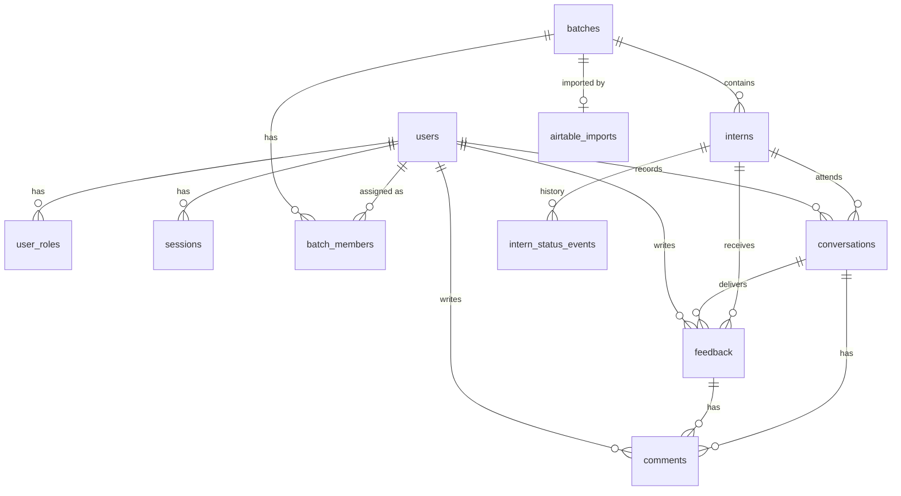

# Intern Feedback Portal — Data Model

Database: PostgreSQL 18 (18.6) via Drizzle.

Conventions:
- **Primary keys:** `uuid` v7 (time-sortable). The app generates them (`newId()` in `shared/ids.ts`), so an entity has its ID before it is saved. Columns also default to Postgres 18's `uuidv7()`, for rows inserted by hand.
- **Timestamps:** `timestamptz`.
- **Column names:** `snake_case`.
- **Enums:** defined once in `packages/contracts` (Zod) and mirrored as Postgres enums.

## 1. Entity overview

| Bounded context | Tables |
|---|---|
| identity | `users`, `user_roles`, `sessions` |
| cohort | `batches`, `batch_members` |
| intern | `interns`, `intern_status_events`, `airtable_imports` |
| feedback | `feedback`, `conversations`, `comments` |

## 2. Enums

| Enum | Values |
|---|---|
| `role` | `admin`, `mentor`, `program_manager` |
| `batch_member_role` | `mentor`, `program_manager` |
| `color_code` | `green`, `yellow`, `borderline_yellow`, `orange`, `borderline_red`, `red` |
| `intern_status` | `active`, `on_notice`, `graduated`, `terminated`, `withdrawn` |
| `feedback_state` | `draft`, `submitted`, `delivered` |
| `import_status` | `pending`, `completed`, `failed` |

Color codes have a fixed **severity order**, used for sorting and trend charts. This order lives in the contracts package, not in the database:

`green (1) → yellow (2) → borderline_yellow (3) → orange (4) → borderline_red (5) → red (6)`

"No color code" is stored as `NULL`.

## 3. Tables

### identity

**`users`**
| Column | Type | Notes |
|---|---|---|
| id | uuid PK | |
| email | citext | Unique, case-insensitive at the DB level. The app also trims and lower-cases it. |
| name | text | |
| google_sub | text null | Unique. Filled on first Google sign-in. |
| avatar_url | text null | From the Google profile |
| is_active | boolean | Default `true`. "Removing" a user sets this to `false`, which keeps their feedback and comments attributable. Inactive users cannot sign in, and deactivating a user also deletes their sessions. There is always at least one active admin. |
| last_login_at | timestamptz null | |
| created_at / updated_at | timestamptz | |

**`user_roles`**: global roles. A user must hold `mentor` or `program_manager` before they can be assigned to a batch in that capacity.
| Column | Type | Notes |
|---|---|---|
| user_id | uuid FK → users | |
| role | `role` | |
| granted_by | uuid FK → users null | `NULL` = granted by the system: the bootstrap admin seed, which acts only when no active admin exists |
| granted_at | timestamptz | |
| | | PK (`user_id`, `role`) |

**`sessions`**
| Column | Type | Notes |
|---|---|---|
| id | text PK | SHA-256 hash of the session token. The raw token exists only in the cookie. |
| user_id | uuid FK → users | Indexed, to revoke all of a user's sessions |
| expires_at | timestamptz | Sliding expiry: 7 days after last use, renewed once less than half is left, never more than 30 days after `created_at`. Indexed: expired rows are deleted on each sign-in. |
| user_agent / ip | text null | |
| created_at | timestamptz | |

### cohort

**`batches`**
| Column | Type | Notes |
|---|---|---|
| id | uuid PK | |
| name | citext | Unique, ignoring case |
| start_date | date | |
| end_date | date | Expected graduation date (about start + 18 months). Must be after `start_date` (check constraint). |
| is_archived | boolean | Default `false`. An archived batch is read-only. |
| created_by | uuid FK → users | |
| created_at / updated_at | timestamptz | |

**`batch_members`**: assignment history. Mentors come and go, so rows are never deleted. Unassigning a member sets `unassigned_at`.
| Column | Type | Notes |
|---|---|---|
| id | uuid PK | |
| batch_id | uuid FK → batches | |
| user_id | uuid FK → users | |
| role | `batch_member_role` | |
| assigned_by | uuid FK → users | |
| assigned_at | timestamptz | |
| unassigned_at | timestamptz null | `NULL` means the assignment is current |
| unassigned_by | uuid FK null | |

Constraints:
- Partial unique (`batch_id`) where `role = 'program_manager' AND unassigned_at IS NULL`. This enforces **one PM per batch**.
- Partial unique (`batch_id`, `user_id`, `role`) where `unassigned_at IS NULL`. This prevents duplicate current assignments.
- There is no limit on how many batches a user belongs to, so **one PM can run many batches**.
- Checks: `unassigned_at` and `unassigned_by` are both null or both set, and `unassigned_at >= assigned_at`.
- Partial index on (`user_id`) where `unassigned_at IS NULL`, for the viewer's current batches (visibility scope).
- No foreign key cascades on `batches` or `batch_members`: batches are archived and users deactivated, never deleted, so a delete fails instead of erasing history.

### intern

**`interns`**
| Column | Type | Notes |
|---|---|---|
| id | uuid PK | |
| batch_id | uuid FK → batches | An intern belongs to exactly one batch |
| airtable_record_id | text null | Airtable record the intern was last imported from |
| username | citext | Stored lower-cased, without the `@` (7.3). Unique within the batch (`batch_id`, `username`). Shown as `@username`. Re-imports match on it. |
| name | text | |
| email | text | Lower-cased |
| phone | text null | |
| diploma_branch | text null | |
| parent_names | text null | |
| interview_notes | text null | Markdown |
| airtable_fields | jsonb null | Raw snapshot of the Airtable record, for fields not modelled here ("etc.") |
| photo_public_id | text null | Cloudinary `public_id` |
| status | `intern_status` | Default `active`. **Denormalized**; the source of truth is `intern_status_events`. |
| color_code | `color_code` null | **Denormalized** current code. The source of truth is the latest submitted `feedback` with a code. |
| notice_ends_on | date null | Set while the intern is `on_notice` |
| created_at / updated_at | timestamptz | |

Index on (`batch_id`, `status`). Unique (`batch_id`, `username`).

Checks: `notice_ends_on` is set exactly when `status = 'on_notice'`; `email = lower(email)`; `username` and `name` contain a non-space character. No foreign key cascades: interns aren't deleted.

**`intern_status_events`**: append-only, never updated.
| Column | Type | Notes |
|---|---|---|
| id | uuid PK | |
| intern_id | uuid FK → interns | |
| from_status | `intern_status` null | `NULL` for the initial `active` event at onboarding |
| to_status | `intern_status` | |
| reason | text | Markdown. Required for every change except onboarding. |
| notice_starts_on / notice_ends_on | date null | Required when `to_status = on_notice` |
| feedback_id | uuid FK null | The feedback marked as notice that started it, if any |
| actor_id | uuid FK → users | |
| created_at | timestamptz | |

Index on (`intern_id`, `created_at`). **A trigger rejects `UPDATE` and `DELETE`** (append-only). `feedback_id` references `feedback` (9.1).

Checks: `from_status` differs from `to_status`; `from_status` is `NULL` only for `to_status = 'active'` (onboarding); `feedback_id` only on an event going `on_notice`; a non-blank `reason` unless onboarding; both notice dates, with the end after the start, exactly when `to_status = 'on_notice'`.

**`airtable_imports`**: one row per import run. A batch can be imported many times. The Airtable token is never stored.
| Column | Type | Notes |
|---|---|---|
| id | uuid PK | |
| batch_id | uuid FK → batches | Index on (`batch_id`, `created_at`) |
| base_id / table_id | text | Airtable source |
| view | text | What was typed: the view's name or its `viw…` id (8.4 decision 6) |
| status | `import_status` | `pending` while it runs |
| record_count | int | Records read from the view |
| created_count / updated_count / skipped_count | int | Interns added, interns updated (matched by username), invalid rows skipped |
| errors | jsonb null | The invalid rows: row, username and reasons. Never field values |
| failure_reason | text null | Why a run failed, as the person saw it (8.4 decision 5) |
| imported_by | uuid FK → users | |
| created_at / completed_at | timestamptz | `completed_at` is set once the run is no longer pending |

Checks: counts ≥ 0; `completed_at` set exactly when not `pending`; `failure_reason` set exactly when `failed`. A run is all or nothing: a failed run changes no intern.

### feedback

**`feedback`**
| Column | Type | Notes |
|---|---|---|
| id | uuid PK | |
| intern_id | uuid FK → interns | |
| author_id | uuid FK → users | Mentor or PM of the intern's batch |
| period | date | First day of the month the feedback covers (checked); from the batch's start month to the current month (9.2 decision 4) |
| body | text | Markdown. May be blank while a draft, not once submitted |
| color_code | `color_code` null | `NULL` means "leave unchanged" |
| gives_notice | boolean | Default `false`. When `true`, submitting the feedback puts the intern `on_notice` for one month from the day it's submitted, in the same transaction. Only for an `active` intern; any colour code (or none) can go with it (9.2 decisions 1 and 2). |
| state | `feedback_state` | `draft` → `submitted` → `delivered` |
| conversation_id | uuid FK null → conversations | Set exactly when the feedback is delivered. **Unique:** one conversation delivers one feedback (10.1 decision 1) |
| submitted_at | timestamptz null | Set exactly when the feedback is no longer a draft |
| created_at / updated_at | timestamptz | |
| edited_at | timestamptz null | When its author last changed it after submitting (9.8); never on a draft. Delivery moves only `updated_at` |

The colour before each entry ("orange → borderline_red") isn't stored: it's the colour of the coloured, non-draft feedback submitted just before, worked out when read (9.8 decision 1), so an edit to older feedback keeps the chain right.

Indexes: (`intern_id`, `period`); (`intern_id`, `submitted_at`) where `color_code IS NOT NULL`; (`author_id`, `state`) for an author's drafts; unique (`conversation_id`).

Checks: `period` is the first of a month; `submitted_at` exactly when not `draft`; `conversation_id` exactly when `delivered`; no `edited_at` on a draft; a non-blank body once submitted. **A trigger rejects deleting anything but a draft, and any update of delivered feedback** (9.1 decisions 1 and 2).

**`conversations`**: a one-on-one in which the PM delivers **one** feedback entry (v2 A8; 10.1 decision 1).
| Column | Type | Notes |
|---|---|---|
| id | uuid PK | |
| intern_id | uuid FK → interns | |
| recorded_by | uuid FK → users | The PM, shown as "Delivered by" |
| held_on | date | "Date delivered" |
| notes | text | Markdown, required (checked non-blank): how it went and what new information came up |
| created_at / updated_at | timestamptz | |
| edited_at | timestamptz null | When the notes or date were changed after recording (10.1 decision 2) |

Index: (`intern_id`, `held_on`). **A trigger refuses deleting a conversation** (10.1 decision 2), so delivered feedback always keeps it.

**`comments`**: a flat thread on **either** a feedback entry or a conversation (10.1 decision 4).
| Column | Type | Notes |
|---|---|---|
| id | uuid PK | |
| feedback_id | uuid FK null → feedback | Set when the comment is on a feedback entry |
| conversation_id | uuid FK null → conversations | Set when the comment is on a conversation |
| author_id | uuid FK → users | |
| body | text | Non-blank, except once deleted |
| created_at / updated_at | timestamptz | |
| edited_at | timestamptz null | "· edited" |
| deleted_at | timestamptz null | Soft delete: the body is cleared and the UI shows "This comment was deleted." (10.1 decision 3) |

Checks: `num_nonnulls(feedback_id, conversation_id) = 1`, so each comment belongs to exactly one parent; a non-blank body unless deleted. Indexes: (`feedback_id`, `created_at`) and (`conversation_id`, `created_at`), each where its column is set. **A trigger refuses deleting a comment and any change to one already deleted.**

## 4. Domain rules (enforced in the domain layer)

**Color codes**
- A color code changes only through feedback: when an entry with a non-null `color_code` is **submitted**, or when its author **edits** submitted feedback (9.8).
- `interns.color_code` is the colour of the newest submitted coloured feedback, updated in the same transaction; the history is derived from `feedback`.
- Feedback with no colour leaves the code alone, so submitting can't set it back to "no code". Only an edit that takes the colour off the only coloured feedback does.

**Feedback lifecycle**
- `draft`: visible and editable only by the author, who can also discard it.
- `submitted`: visible to all current mentors and the PM of the batch. Until delivery, **its author can change anything**: month, text, color code and notice (9.8). The intern's color code then follows their newest coloured feedback (it can go back to none). Switching notice on starts one from that day; switching it off withdraws the notice this feedback gave, only while it still runs. Both are recorded in the status history.
- `delivered`: immutable (the database refuses any change). Attached to a conversation.
- Several mentors can submit feedback for the same intern and month. The PM delivers each in its own conversation (10.1 decision 1).
- Comments on feedback are allowed once it is `submitted`, and they stay open after delivery. A comment adds context without changing the original entry. Drafts cannot be commented on.

**Conversations**
- Only the batch's current PM can record a conversation (10.2 decision 1). It delivers **one** submitted feedback entry, which becomes `delivered` in the same transaction.
- "Date delivered" is a day from the feedback's submission to today, in UTC (decision 2). The notes are required.
- The batch's current PM can change the notes and date later, whoever recorded it, marking it edited (decision 3). The feedback it delivered never changes.
- Nothing is recorded or changed for a read-only intern or in an archived batch (decision 4).
- Every current mentor and the PM of the batch can comment.

**Status transitions**

| From | To | Who | Trigger |
|---|---|---|---|
| — | `active` | Admin or PM | Onboarding / import |
| `active` | `on_notice` | Mentor or PM of the batch | Submitting feedback with `gives_notice = true`. Notice runs one month from the submission day; the history reads "Notice given in the October 2026 feedback." and points at the feedback. |
| `on_notice` | `active` | PM | Notice lifted, with a reason |
| `on_notice` | `terminated` | PM | Notice period ended, with a reason |
| `active` | `graduated` | PM | Program completed, with a reason |
| `active` / `on_notice` | `withdrawn` | PM | Intern left, with a reason |

- `graduated`, `terminated`, and `withdrawn` are final. The intern becomes read-only.

**Access**
- Mentors and PMs see only batches where they have a **current** assignment (`unassigned_at IS NULL`).
- Admins see all batches.
- Inactive users cannot sign in.

## 5. Authorization matrix

| Action | Admin | PM (of batch) | Mentor (of batch) |
|---|:-:|:-:|:-:|
| Manage users and roles | ✅ | | |
| Create or archive batch | ✅ | | |
| Import interns from Airtable (repeatable) | ✅ | ✅ | |
| Assign or unassign mentors | ✅ | ✅ | |
| Assign PM | ✅ | | |
| View interns and submitted feedback | ✅ | ✅ | ✅ |
| Write feedback, set color code, mark as notice | ✅* | ✅ | ✅ |
| Record conversation | | ✅ | |
| Change intern status | | ✅ | |
| Comment on feedback or conversation | ✅* | ✅ | ✅ |
| Upload intern photo | ✅ | ✅ | |

Photos follow the design (7.7 decision 1): admins and the batch's PM, not mentors.

\* An admin writes feedback or comments only if they are also assigned to the batch as a mentor or PM. Admin rights alone give read access to a batch, not write access to feedback.

## 6. Confirmed decisions

1. **Color code takes effect when feedback is submitted**, not when it is delivered. Mentors then share the current view right away. The intern hears about it at the next one-on-one.
2. **An intern cannot be terminated without first going through notice.** If immediate termination is needed, add `active → terminated`.
3. **Comments can go on both feedback entries and conversations.** For example, a mentor adds context to another mentor's feedback.
4. **Admins without a batch assignment are read-only** for that batch's feedback.
5. **Submitted feedback is never deleted.** Only a draft can be discarded by its author (v2 A26), since nobody else has seen it. There is no soft-delete column, and the database refuses to delete anything else.
6. **Termination is manual.** `notice_ends_on` passing changes nothing by itself; the PM terminates or lifts the notice.
